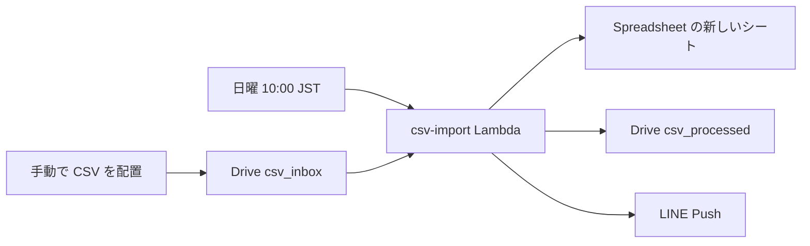

# 日曜 CSV をスプレッドシートへ取り込む

既存の週次ジョブ（[lambda/weekly.js](../lambda/weekly.js)、[lambda/kindle.js](../lambda/kindle.js)、[infra/app.js](../infra/app.js)）と同じく、EventBridge Scheduler から Lambda を起動する。Drive と LINE の認証は今の Secrets Manager（サービスアカウント、`lineChannelAccessToken`、`lineUserId`）を流用する。

## 手動側の準備（初回のみ）

毎週のシート作成・セル書き込みは API が行う。Google 側で毎週やる操作はない。初回だけ次を済ませる。

### Google Sheets API を有効にする

Drive API が有効でも Sheets API は別物です。未設定のまま書き込むと `403 Sheets API has not been used in project ...` になります。有効化だけで、サービスアカウントの鍵・IAM ロール・OAuth クライアントは作りません。scope はコード側の JWT で付けます。

1. 有効化するプロジェクトを特定する。AWS コンソールの Secrets Manager（`ap-northeast-1`）で `notes-pipeline/credentials` を開き、`googleServiceAccount.client_email` を見る。`名前@プロジェクトID.iam.gserviceaccount.com` の `@` と `.iam.gserviceaccount.com` のあいだがプロジェクト ID です。ローカルなら `.env` の `GOOGLE_SERVICE_ACCOUNT_JSON` でも同じメールアドレスを確認できます。
2. そのサービスアカウントを作った Google アカウントで [Google Cloud コンソール](https://console.cloud.google.com/) にログインする。
3. 画面上部のプロジェクト選択で、手順 1 のプロジェクト ID を選ぶ。表示名と ID が違うことがあるので、一覧の ID 列で合わせる。別の空プロジェクトを選ぶと、今の Drive 用アカウントからは書けません。
4. 左上のメニューから **API とサービス** → **ライブラリ** を開く。直接開く場合は `https://console.cloud.google.com/apis/library/sheets.googleapis.com?project=プロジェクトID` です。
5. 検索ボックスに `Google Sheets API` と入力し、提供元が Google の **Google Sheets API** を開く。
6. **有効にする** をクリックする。数十秒で完了し、ボタンが **管理** に変わります。最初から **管理** と出ている場合は、すでに有効です。
7. **API とサービス** → **有効な API とサービス** を開き、一覧に Google Sheets API があることを確認する。

有効化の画面で「認証情報を作成」と出ても、新しい鍵や OAuth クライアントは作りません。請求先アカウントの追加を求められたときだけ、そのプロジェクトに請求先が無いので既存の請求先を紐づけます。Drive 用の鍵が既に動いているプロジェクトでは、通常この操作は出ません。Sheets API の呼び出し自体に、この個人利用の範囲で追加料金はかかりません。

### フォルダとスプレッドシート

- Drive に `csv_inbox` と `csv_processed` を作り、既存のサービスアカウント（`client_email`）に共有する。画像用の `00_notes_inbox` とは分ける。
- 取り込み先のスプレッドシートは作成済み。タブは空のままでよい。同じサービスアカウントを**編集者**で共有する。閲覧者ではシート追加も書き込みもできない。
  - URL: `https://docs.google.com/spreadsheets/d/1nKB9S7EHVue05Kcwb3F_VGVOHHuYBJ1F84-pUwQCHNU/edit`
  - スプレッドシート ID: `1nKB9S7EHVue05Kcwb3F_VGVOHHuYBJ1F84-pUwQCHNU`
- この ID を Lambda の環境変数 `CSV_SPREADSHEET_ID` に置く。
- シート全体が保護されている場合は、サービスアカウントが編集できる保護設定にする。

毎週の手作業は、`csv_inbox` へ UTF-8 の `.csv` を置くことだけ。Excel の Shift_JIS 書き出しはこの対象外。Apps Script、OAuth の再ログイン、タブの事前作成、公開設定は使わない。

## 自動処理

日曜 10:00 JST（`weekDay: SUN`, `hour: 10`, `minute: 0`, `Asia/Tokyo`）。9:00 の週次要約・リマインドと通知が重ならないようにする。

[lambda/csv-import.js](../lambda/csv-import.js) の流れ:

1. `csv_inbox` 直下の `.csv`（`text/csv` または拡張子 `.csv`）を列挙する。
2. 0件なら LINE に「今週対象のCSVはありませんでした」と送り、シートは作らない。
3. 各ファイルについて、シート名 `YYYY-MM-DD_<ファイル名stem>`（JST、シート名に使えない文字は除く）で新しいシートを追加し、CSV の全セルを `RAW` で書く。1行目もヘッダーとしてそのまま書く。
4. 書き込みが成功したファイルだけ `csv_processed` へ移す（[lambda/drive.js](../lambda/drive.js) の `moveFile` を使う）。
5. 全ファイルの処理後に LINE を1通送る。成功件数、失敗件数、Sheets アプリで開くリンク（`googlesheets://https://docs.google.com/spreadsheets/d/<id>/edit`）、失敗したファイル名を入れる。特定のシートへの gid は付けない。iOS の Sheets アプリはこのスキームではタブを指定できない。

失敗したファイルは inbox に残す。同名シートが既にある場合はそのファイルを失敗にし、上書きしない。

Sheets API は Drive とは別クライアントにする。JWT の scope は `https://www.googleapis.com/auth/spreadsheets` のみ。呼び出しは [lambda/drive.js](../lambda/drive.js) と同じく `google-auth-library` と `fetch`（`spreadsheets.batchUpdate` でシート追加、`values.update` で書き込み）。新しい npm 依存は足さない。CSV は引用符・カンマ・セル内改行を扱う小さなパーサをテスト付きで置く。

## 変更するファイル

- 新規: `lambda/csv-import.js`、`lambda/csv.js`（パースとシート名）、`lambda/sheets.js`、`test/csv-import.test.js`
- [lambda/const.ts](../lambda/const.ts): フォルダ名の既定値
- [lambda/line.js](../lambda/line.js): 完了・対象なし・失敗の文面
- [infra/app.js](../infra/app.js): Lambda、環境変数、日曜 10:00 の Schedule
- [README.md](../README.md) と [specifications/request-sequence.md](request-sequence.md): このジョブの説明

## テスト

`node:test` で、パース、シート名、0件、1件成功（シート追加・書き込み・移動・LINE）、シート名の衝突、書き込み失敗時は移動しない、をモックで確認する。

## 実装時の作業

実装済み。

- UTF-8 CSV パーサとシート名生成をテスト付きで追加する
- Sheets API クライアント（シート追加と RAW 書き込み）を追加する
- csv-import ハンドラ：取得、書き込み、processed へ移動、LINE 通知
- CDK の日曜 10:00 スケジュールと README / request-sequence を追加する
