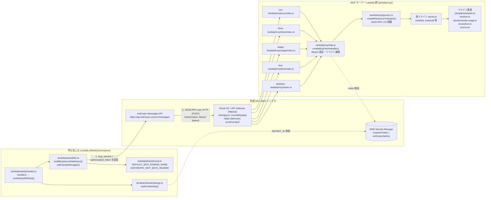
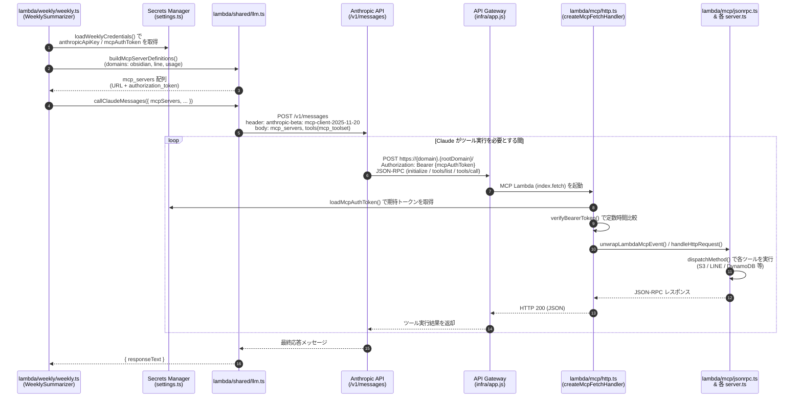

# Lambda からの MCP 呼び出しフローとファイル連携図

Lambda 関数が MCP（Model Context Protocol）サーバーを呼び出す際の仕組みと、リポジトリ内ファイル同士のつながりをまとめる。

> [!NOTE]
> 呼び出し元 Lambda は MCP サーバー（API Gateway）へ直接 HTTP リクエストを送信するのではなく、**Anthropic Messages API のリモート MCP クライアント機能（`mcp_servers` + `anthropic-beta: mcp-client-2025-11-20`）** を経由して間接的に MCP サーバーを呼び出す。

現在、バッチ Lambda から MCP を利用しているのは週次要約バッチ（`lambda/weekly/weekly.ts`、`USE_MCP_SERVERS=true` 時）である。

---

## 1. ファイル間のつながり（依存・呼び出し構造）

---

## 2. 実行時リクエストシーケンス

---

## 3. MCP エンドポイントと実装ファイルの対応表

`infra/app.js` の `mountMcpApi()` により、各 MCP サーバー Lambda にはサブドメインと API Gateway (`POST /`) が割り当てられる。

| ドメイン (`McpDomainName`) | サーバー名 (`MCP_SERVER_NAMES`) | エンドポイント URL | CDK Lambda ID / 関数名 | エントリポイント | サーバー実装 |
| :--- | :--- | :--- | :--- | :--- | :--- |
| `obsidian` | `obsidian-s3` | `https://obsidian.<rootDomain>/` | `ObsidianMcp` (`obsidian-s3-mcp`) | `lambda/mcp/index.ts` | `lambda/mcp/obsidian/server.ts` |
| `drive` | `google-drive` | `https://drive.<rootDomain>/` | `DriveMcp` (`google-drive-mcp`) | `lambda/mcp/drive/index.ts` | `lambda/mcp/drive/server.ts` |
| `csv` | `household-csv` | `https://csv.<rootDomain>/` | `CsvMcp` (`household-csv-mcp`) | `lambda/mcp/csv/index.ts` | `lambda/mcp/csv/server.ts` |
| `line` | `line-notification` | `https://line.<rootDomain>/` | `LineMcp` (`line-notification-mcp`) | `lambda/mcp/line/index.ts` | `lambda/mcp/line/server.ts` |
| `usage` | `claude-usage` | `https://usage.<rootDomain>/` | `UsageMcp` (`claude-usage-mcp`) | `lambda/mcp/usage/index.ts` | `lambda/mcp/usage/server.ts` |

- **共通トランスポート・認証**: すべての MCP エントリポイントは `lambda/mcp/http.ts` の `createMcpFetchHandler()` と `lambda/mcp/jsonrpc.ts` の `createMcpServerTransport()` を共有している。
- **ローカル stdio 実行**: `lambda/mcp/stdio.ts` は HTTP 経由ではなく標準入出力（stdio）で Obsidian MCP サーバーを起動するための別エントリポイント。
