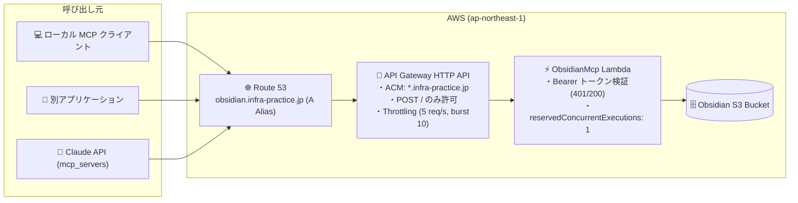

# Phase 1 実装計画: `obsidian.infra-practice.jp` 独自ドメイン化 & API Gateway 移行

## 1. 目的・背景

現在、`ObsidianMcp`（`obsidian-s3-mcp`）は Lambda Function URL（`AuthType: NONE`）で公開されている。これを独自サブドメイン `https://obsidian.infra-practice.jp/` へ移行し、以下の 3 点を達成する。

1. **セキュリティ強化**: Function URL の公開を廃止し、API Gateway（HTTP API）を前段に配置して **レート制限（Throttling）** と **`POST /` ルート限定**（不正パス・不正メソッドを Lambda 起動前に遮断）を導入する。
2. **独自ドメイン統一**: `https://obsidian.infra-practice.jp/` でローカル・別アプリ・Claude API（`mcp_servers`）から一貫して接続できるようにする。
3. **横展開の「型」の確立**: 今後追加予定の `drive.infra-practice.jp` 等でも再利用できる、Route 53 + ACM（`*.infra-practice.jp`）+ API Gateway HTTP API の CDK パターンを確立する。

※ 既存の 5 つの定期実行 Lambda（`Handler`, `WeeklySummarizer`, `WeeklyReminder`, `CsvImport`, `KindleSummarizer`）は変更せず、無停止で稼働を継続する。

---

## 2. ターゲットアーキテクチャ



---

## 3. 事前確認・前提条件（インフラ準備）

デプロイ前に、`infra-practice.jp` に関する以下 2 点を確認・用意する。

### 3.1 Route 53 ホストゾーン
- `infra-practice.jp` のパブリックホストゾーンが AWS Route 53 に作成済みであること。
- ドメインレジストラ（お名前.com / Cloudflare 等）側の NS レコードが、Route 53 の 4 つのネームサーバーに向けられていること。
- ※ 共通インフラ（別リポジトリ / Terraform 等）でホストゾーンと ACM 証明書を管理する場合は、**ホストゾーン ID** と **証明書 ARN** を控えて CDK 側から参照する。

### 3.2 ACM ワイルドカード証明書（東京リージョン `ap-northeast-1`）
- API Gateway HTTP API（リージョナルエンドポイント）で使用するため、証明書は **Lambda と同じ `ap-northeast-1` リージョン** に発行する。
- ドメイン名に `*.infra-practice.jp`（必要に応じて `infra-practice.jp` も SAN に追加）を指定し、**DNS 検証** で `ISSUED` 状態にする。
- ワイルドカード証明書を 1 枚用意しておけば、今後の `drive.infra-practice.jp` 等でも追加発行・追加費用なしで使い回せる。

---

## 4. 実装変更計画

### 4.1 CDK インフラ定義（`infra/app.js`）

`aws-cdk-lib`（v2.277.0）に含まれる標準 L2 コンストラクトを使用する（追加パッケージ不要）。

- 利用モジュール:
  - `aws-cdk-lib/aws-apigatewayv2`（`HttpApi`, `HttpMethod`, `DomainName`）
  - `aws-cdk-lib/aws-apigatewayv2-integrations`（`HttpLambdaIntegration`）
  - `aws-cdk-lib/aws-certificatemanager`（`Certificate`）
  - `aws-cdk-lib/aws-route53`（`HostedZone`, `ARecord`, `RecordTarget`）
  - `aws-cdk-lib/aws-route53-targets`（`ApiGatewayv2DomainProperties`）

#### 主な変更内容

1. **Function URL の削除**:
   - `obsidianMcp.addFunctionUrl(...)` と `ObsidianMcpFunctionUrl` の `CfnOutput` を削除し、Function URL 経由の直接公開を停止する。
2. **ドメイン・証明書の参照**:
   - 環境変数または CDK コンテキスト（例: `MCP_DOMAIN_NAME` = `infra-practice.jp`, `MCP_HOSTED_ZONE_ID`, `MCP_CERTIFICATE_ARN`）から参照する形にする（未指定時は既存のホストゾーン検索 `HostedZone.fromLookup` やオプション化により、既存定期バッチのみのデプロイを壊さない設計にする）。
3. **API Gateway HTTP API + カスタムドメイン + レート制限**:
   ```javascript
   const mcpDomain = new DomainName(this, "ObsidianMcpDomain", {
     domainName: `obsidian.${rootDomain}`,
     certificate,
   });

   const mcpApi = new HttpApi(this, "ObsidianMcpApi", {
     apiName: "obsidian-s3-mcp-api",
     createDefaultStage: true,
     defaultDomainMapping: {
       domainName: mcpDomain,
     },
   });

   // デフォルトステージにレート制限を設定（ブルートフォース・過剰課金防止）
   const defaultStage = mcpApi.defaultStage?.node.defaultChild;
   if (defaultStage) {
     defaultStage.defaultRouteSettings = {
       throttlingRateLimit: 5,
       throttlingBurstLimit: 10,
     };
   }

   mcpApi.addRoutes({
     path: "/",
     methods: [HttpMethod.POST],
     integration: new HttpLambdaIntegration("ObsidianMcpIntegration", obsidianMcp),
   });

   new ARecord(this, "ObsidianMcpAliasRecord", {
     zone: hostedZone,
     recordName: "obsidian",
     target: RecordTarget.fromAlias(
       new ApiGatewayv2DomainProperties(mcpDomain.regionalDomainName, mcpDomain.regionalHostedZoneId),
     ),
   });
   ```
4. **CfnOutput の更新**:
   - `ObsidianMcpEndpointUrl` として `https://obsidian.infra-practice.jp/` を出力する。

---

### 4.2 MCP Lambda ハンドラーの互換性確認（`lambda/mcp/index.ts`）

- API Gateway HTTP API（Payload format version 2.0）からのリクエストイベントは、`headers`（小文字キー含む）・`body`・`isBase64Encoded` を持つ。
- 現在の [lambda/mcp/index.ts](file:///Users/ks/workspaces/transcribe-save-to-notes-app/lambda/mcp/index.ts) の `extractEventAuthHeader`（大文字小文字を区別しない `authorization` 検索）と `unwrapLambdaMcpEvent` で処理可能だが、Bun Lambda ランタイムアダプタ経由で渡される実リクエスト形式に合わせてテストを補強する。

---

### 4.3 ユニットテストの追加（`lambda/mcp/obsidian/obsidian-mcp.test.ts`）

- API Gateway HTTP API v2 形式のイベントペイロード（`version: "2.0"`, `routeKey: "POST /"`, `headers: { authorization: "Bearer ..." }`, `body`, `isBase64Encoded`）を模したテストケースを追加し、認証失敗（401）と正常応答（200）を検証する。

---

## 5. コスト見積もり（東京リージョン `ap-northeast-1`）

| リソース | 単価 / 枠 | 個人利用での月額目安 |
| :--- | :--- | :--- |
| ACM 証明書（`*.infra-practice.jp`） | 無料 | **$0** |
| Route 53 レコード追加 | ホストゾーン $0.50/月（既存利用なら追加 $0） | **追加 $0** |
| API Gateway HTTP API | $1.29 / 100万リクエスト | **約 $0.001（1 円未満）** |

---

## 6. 作業手順・検証計画

### Step 1: 自動テスト・CDK 差分確認
```bash
bun run typecheck && bun run check && bun run test
npx cdk diff
```

### Step 2: デプロイ
```bash
npx cdk deploy
```
※ `NotesPipelineStack.ObsidianMcpEndpointUrl = https://obsidian.infra-practice.jp/` が出力されること、および旧 Function URL が削除されていることを確認する。

### Step 3: 疎通・セキュリティ確認
1. **認証なしが `401` で弾かれること**:
   ```bash
   curl -i -X POST "https://obsidian.infra-practice.jp/" \
     -H "content-type: application/json" \
     -d '{"jsonrpc":"2.0","id":1,"method":"tools/list"}'
   ```
2. **不正パス / GET メソッドが API Gateway 側で拒否されること（404）**:
   ```bash
   curl -i "https://obsidian.infra-practice.jp/invalid"
   ```
3. **Bearer トークン付きで `obsidian_list_notes` が成功すること**:
   ```bash
   TOKEN="<mcpAuthToken>" bun -e '
   const res = await fetch("https://obsidian.infra-practice.jp/", {
     method: "POST",
     headers: { "content-type": "application/json", authorization: `Bearer ${process.env.TOKEN}` },
     body: JSON.stringify({ jsonrpc: "2.0", id: 2, method: "tools/call", params: { name: "obsidian_list_notes", arguments: { folder: "00_daily_notes" } } }),
   });
   console.log(JSON.stringify(await res.json(), null, 2));
   '
   ```

### Step 4: クライアント接続先の切り替え
- ローカルの MCP 設定や別アプリ側のエンドポイント URL を旧 `*.lambda-url...` から `https://obsidian.infra-practice.jp/` へ更新する。

---

## 7. Phase 1 完了後の拡張ロードマップ

- **Phase 2**: 同じ `ObsidianMcp`（`https://obsidian.infra-practice.jp/`）にプロンプト群（`prompts/list`, `prompts/get`）を追加
- **Phase 3**: 本計画で確立した CDK パターンを使い、`drive.infra-practice.jp` 等を別サブドメインとして順次追加
