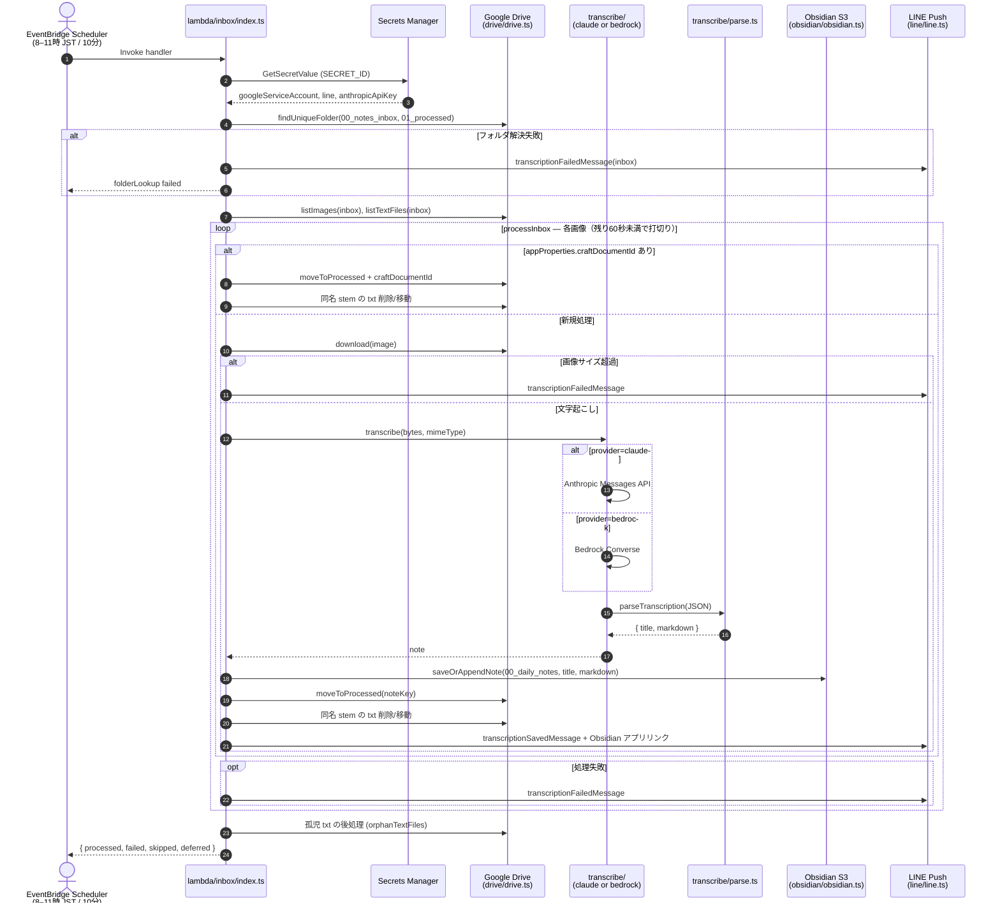
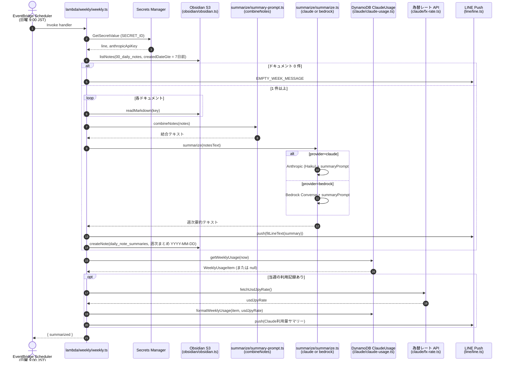
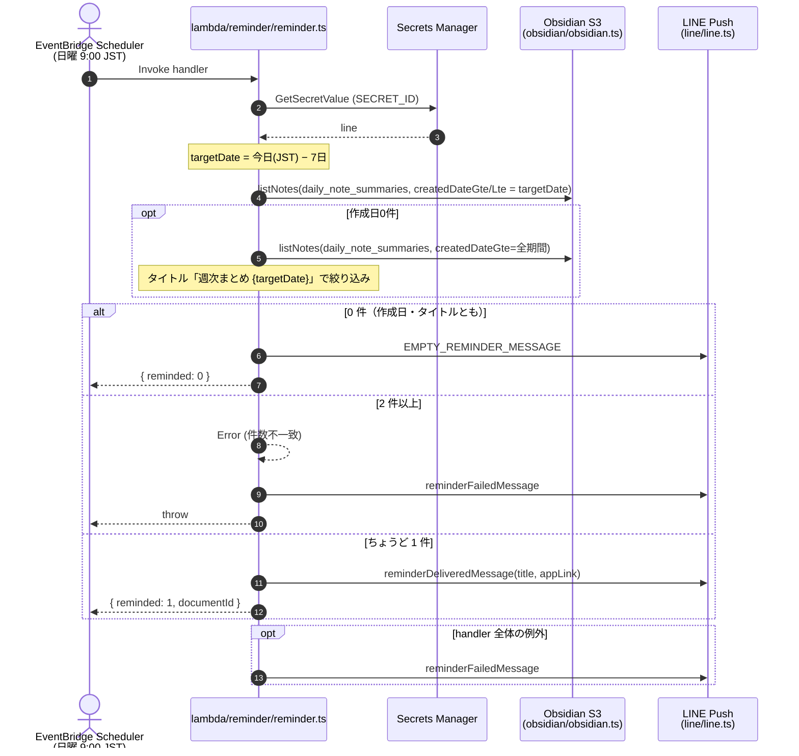
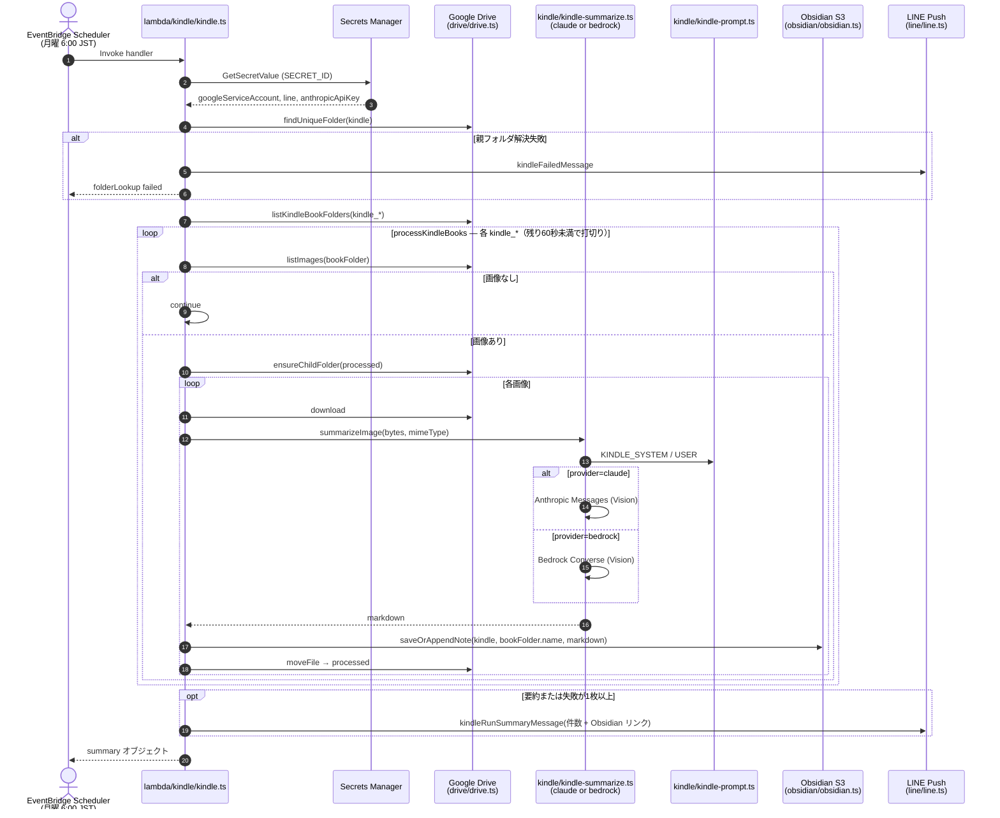
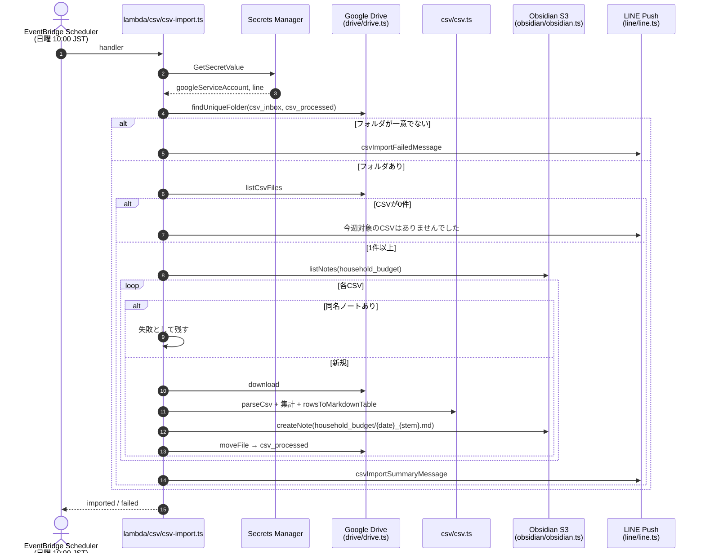

# リクエストシーケンス

各 Lambda のエントリポイントと外部連携の流れ。インフラ定義は `infra/app.js`、処理本体は `lambda/` を参照。

## Lambda 一覧

| CDK 論理 ID | 関数名 | エントリ | スケジュール (JST) |
|-------------|--------|----------|-------------------|
| Handler | (スタック生成名) | `lambda/inbox/index.ts` | 毎日 8:00–11:50、10分間隔 |
| WeeklySummarizer | `craft-weekly-summarizer` | `lambda/weekly/weekly.ts` | 毎週日曜 9:00 |
| WeeklyReminder | `craft-weekly-reminder` | `lambda/reminder/reminder.ts` | 毎週日曜 9:00 |
| CsvImport | `csv-spreadsheet-import` | `lambda/csv/csv-import.ts` | 毎週日曜 10:00 |
| KindleSummarizer | `craft-kindle-summarizer` | `lambda/kindle/kindle.ts` | 毎週月曜 6:00 |

共通: Secrets Manager (`SECRET_ID`)、ランタイムは Bun (`provided.al2023` / `arm64`)、`TRANSCRIPTION_PROVIDER` は `claude` または `bedrock`。

---

## Handler — 朝の文字起こしパイプライン (`lambda/inbox/index.ts`)

Google Drive の `00_notes_inbox` 内画像を文字起こしし、Obsidian Vault 用 S3 バケットの `00_daily_notes` に保存（既存があれば追記）。処理済みは `01_processed` へ移動。成功・失敗を LINE に通知（資格情報が無い場合はログのみ）。

---

## WeeklySummarizer — 週次要約 (`lambda/weekly/weekly.ts`)

Obsidian S3 バケットの `00_daily_notes` 内の直近7日分ノートを要約し LINE に送信。同内容を `daily_note_summaries` に保存する（`00_daily_notes` の元ノートは移動しない）。さらに DynamoDB（`ClaudeUsage`）から当週の Claude 利用量を取得し、為替レート（`claude/fx-rate.ts`）で円換算して LINE に通知。

---

## WeeklyReminder — 週次リマインド (`lambda/reminder/reminder.ts`)

`daily_note_summaries` 内で「実行日の7日前」に作成されたノートを1件だけ LINE で再通知（タイトル + Obsidian アプリリンク）。

---

## KindleSummarizer — Kindle スクリーンショット要約 (`lambda/kindle/kindle.ts`)

Drive `kindle` 配下の `kindle_*` フォルダ内画像を Vision 要約し、S3 の `kindle/{書籍フォルダ名}.md` へ新規作成または末尾追記する。成功した画像は各 `kindle_*/processed` へ移動。

---

## CsvImport — 家計簿 CSV を Obsidian Markdown テーブルへ取り込む (`lambda/csv/csv-import.ts`)

Drive の `csv_inbox` にある CSV を読み、合計・デビット・現金・月次累計行を付与した Markdown テーブルとして S3 の `household_budget/{YYYY-MM-DD}_{stem}.md` に保存する。成功したファイルだけ `csv_processed` へ移動する。0件は LINE に「今週対象のCSVはありませんでした」。1件以上は成功件数、失敗件数、Obsidian アプリリンク（`obsidian://open?...`）、失敗ファイルを1通で通知する。同名ノートがあるファイルは上書きしない。

---

## モジュール対応表（Lambda 横断）

| モジュール | Handler | Weekly | Reminder | Kindle | Csv |
|------------|:-------:|:------:|:--------:|:------:|:---:|
| `drive/drive.ts` + `drive/helper.ts` | ○ | — | — | ○ | ○ |
| `obsidian/obsidian.ts` + `obsidian/helper.ts` | ○ | ○ | ○ | ○ | ○ |
| `line/line.ts` + `line/helper.ts` | ○ | ○ | ○ | ○ | ○ |
| `claude/claude-usage.ts` + `claude/fx-rate.ts` | ○ | ○ | — | ○ | — |
| `transcribe/*` | ○ | — | — | ○ | — |
| `summarize/summarize.ts` + `summarize/summary-prompt.ts` | — | ○ | — | — | — |
| `kindle/kindle-summarize.ts` + `kindle/kindle-prompt.ts` | — | — | — | ○ | — |
| `csv/csv.ts` + `csv/helper.ts` | — | — | — | — | ○ |
| `shared/*` | ○ | ○ | ○ | ○ | ○ |
