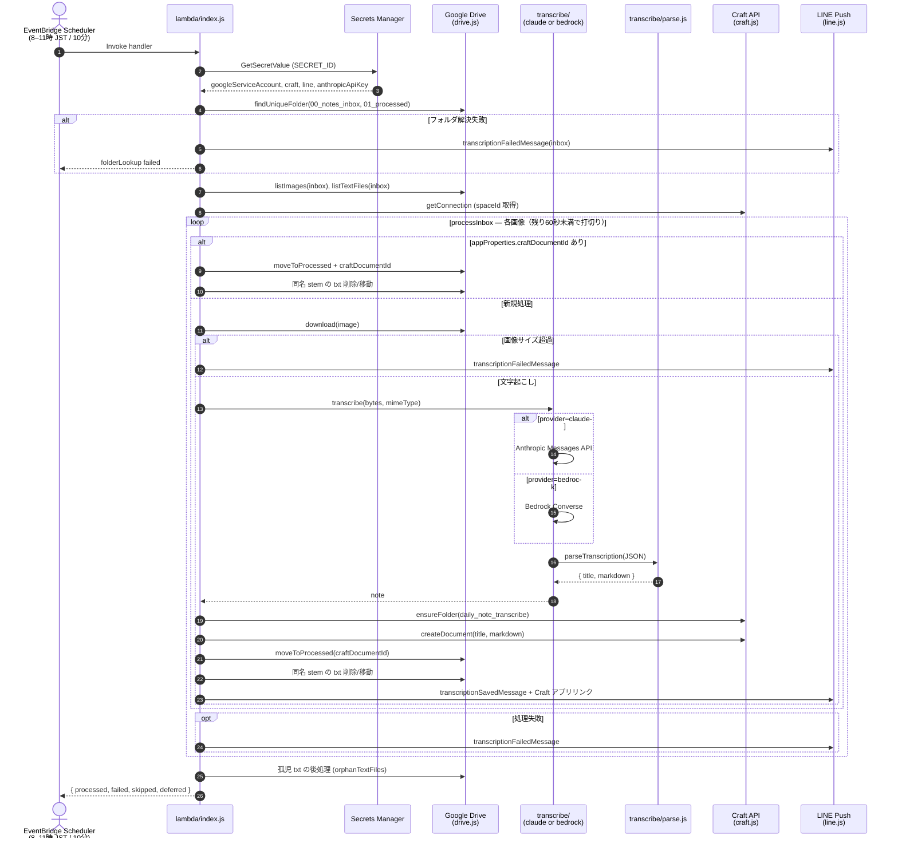
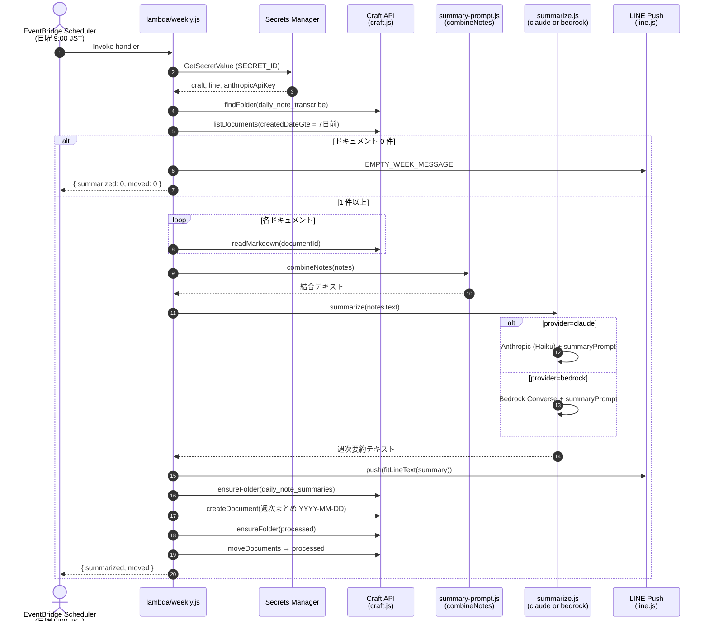
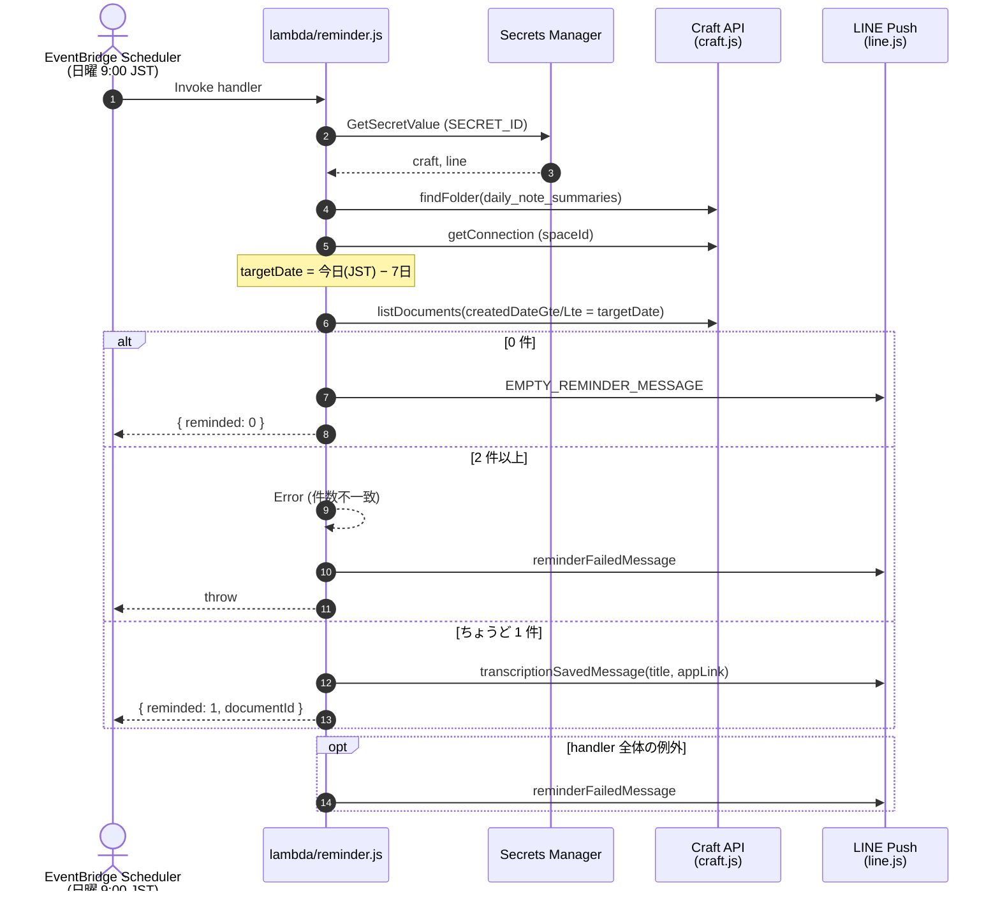
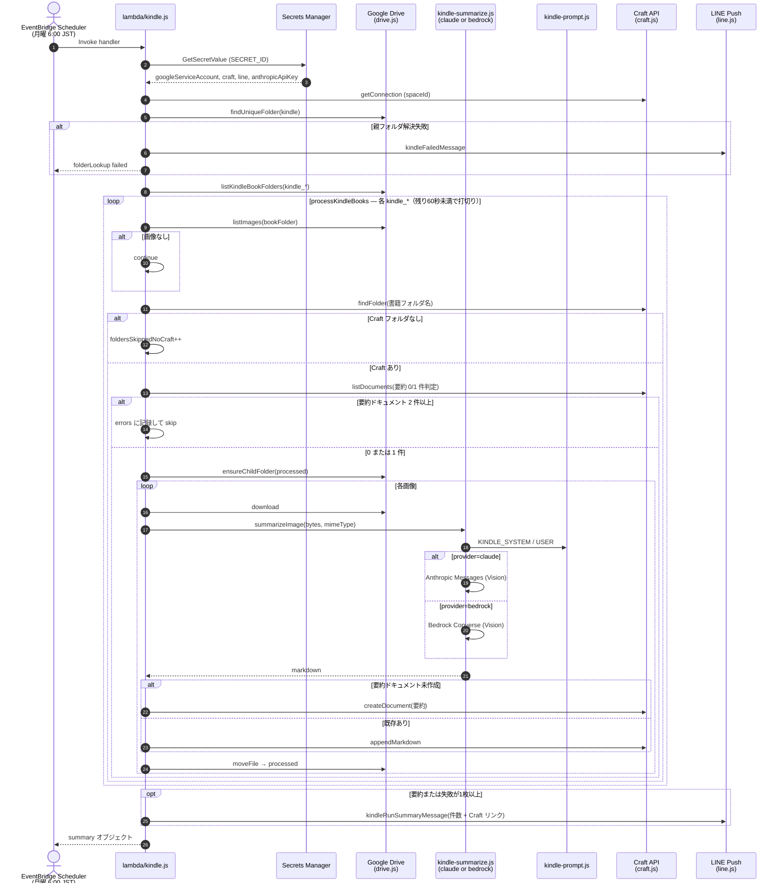

# リクエストシーケンス

各 Lambda のエントリポイントと外部連携の流れ。インフラ定義は `infra/app.js`、処理本体は `lambda/` を参照。

## Lambda 一覧

| CDK 論理 ID | 関数名 | エントリ | スケジュール (JST) |
|-------------|--------|----------|-------------------|
| Handler | (スタック生成名) | `lambda/index.js` | 毎日 8:00–11:50、10分間隔 |
| WeeklySummarizer | `craft-weekly-summarizer` | `lambda/weekly.js` | 毎週日曜 9:00 |
| WeeklyReminder | `craft-weekly-reminder` | `lambda/reminder.js` | 毎週日曜 9:00 |
| KindleSummarizer | `craft-kindle-summarizer` | `lambda/kindle.js` | 毎週月曜 6:00 |

共通: Secrets Manager (`SECRET_ID`)、`TRANSCRIPTION_PROVIDER` は `claude` または `bedrock`。

---

## Handler — 朝の文字起こしパイプライン (`lambda/index.js`)

Google Drive の `00_notes_inbox` 内画像を文字起こしし Craft の `daily_note_transcribe` に保存。処理済みは `01_processed` へ移動。成功・失敗を LINE に通知（資格情報が無い場合はログのみ）。

---

## WeeklySummarizer — 週次要約 (`lambda/weekly.js`)

Craft `daily_note_transcribe` 内の直近7日分ドキュメントを要約し LINE に送信。同内容を `daily_note_summaries` に保存後、元ドキュメントを Craft `processed` へ移動。

---

## WeeklyReminder — 週次リマインド (`lambda/reminder.js`)

`daily_note_summaries` 内で「実行日の7日前」に作成されたノートを1件だけ LINE で再通知（タイトル + Craft アプリリンク）。

---

## KindleSummarizer — Kindle スクリーンショット要約 (`lambda/kindle.js`)

Drive `kindle` 配下の `kindle_*` フォルダ内画像を Vision 要約し、Craft に同名フォルダがあれば「要約」ドキュメントへ追記（無ければ新規、2件以上あればその書籍フォルダはスキップ）。成功した画像は各 `kindle_*/processed` へ移動。

---

## モジュール対応表（Lambda 横断）

| モジュール | Handler | Weekly | Reminder | Kindle |
|------------|:-------:|:------:|:--------:|:------:|
| `drive.js` | ○ | — | — | ○ |
| `craft.js` | ○ | ○ | ○ | ○ |
| `line.js` | ○ | ○ | ○ | ○ |
| `transcribe/*` + `prompt.js` | ○ | — | — | — |
| `summarize.js` + `summary-prompt.js` | — | ○ | — | — |
| `kindle-summarize.js` + `kindle-prompt.js` | — | — | — | ○ |
